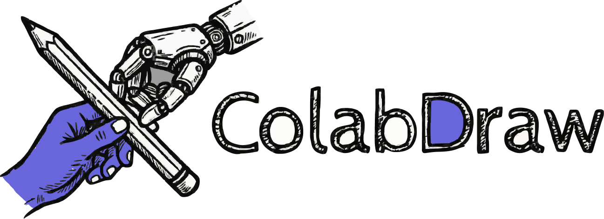

<div align="center">
  
  
  <h1>ColabDraw</h1>
  
  <p>
    <strong>An open source collaborative virtual whiteboard</strong><br/>
    Hand-drawn style • Real-time collaboration • End-to-end encrypted
  </p>
  <!-- DeepWiki Badge -->
  <p>
    <a href="https://deepwiki.com/JyotirmoyDas05/ColabDraw">
      
    </a>
  </p>

  <br/>

  <!-- Badges -->
  <p>
    <a href="https://github.com/JyotirmoyDas05/ColabDraw/blob/master/LICENSE">
      
    </a>
    <a href="https://github.com/JyotirmoyDas05/ColabDraw">
      
    </a>
    <a href="https://github.com/JyotirmoyDas05/ColabDraw/fork">
      
    </a>
  </p>

  <p>
    
    
    
    
    
  </p>

  <p>
    <a href="https://github.com/JyotirmoyDas05/ColabDraw/issues">
      
    </a>
    <a href="https://github.com/JyotirmoyDas05/ColabDraw/pulls">
      
    </a>
    <a href="https://github.com/JyotirmoyDas05/ColabDraw/graphs/contributors">
      
    </a>
    
  </p>

  <p>
    
    
    
  </p>

---

</div>

> [!NOTE] > **ColabDraw** has taken some Components from [Excalidraw](https://github.com/excalidraw/excalidraw), and Fully Customized it according to the Project Author's Likings and is currently Maintained by JyotirmoyDas05. This project maintains the MIT license and includes all original copyright attributions as required.

## Features

The ColabDraw editor supports:

- 💯 Free & open-source
- 🎨 Infinite, canvas-based whiteboard
- ✍️ Hand-drawn like style
- 🌘 Dark mode
- 🏗️ Customizable
- 📷 Image support
- 😀 Shape libraries support
- 🌐 Localization (i18n) support
- 🖼️ Export to PNG, SVG & clipboard
- 💾 Open format - export drawings as an `.excalidraw` json file
- ⚒️ Wide range of tools - rectangle, circle, diamond, arrow, line, free-draw, eraser...
- ➡️ Arrow-binding & labeled arrows
- 🔙 Undo / Redo
- 🔍 Zoom and panning support

## ColabDraw App Features

- ⚡ **Powered by Bun** (ultra-fast builds and installs)
- 📡 PWA support (works offline)
- 🤼 Real-time collaboration via Cloudflare Workers & Durable Objects
- 🔒 End-to-end encryption
- 📊 Web Analytics with Vercel Integration
- 💾 Local-first support (autosaves to the browser)
- 🔗 Shareable links

## Development

### Prerequisites

- Node.js >= 18.0.0
- **Bun >= 1.0.0** (Recommended)

### Quick Start

```bash
# Install dependencies
bun install

# Configure environment variables
cp .env.development.example .env.development
# Edit .env.development if your backend URL is not http://localhost:8787

# Start development server
bun run dev

# Build for production
bun run build
```

### Available Scripts

- `bun run dev` - Start development server (Frontend)
- `bun run build` - Build for production (All packages + App)
- `bun run test` - Run tests
- `bun run fix` - Auto-fix linting and formatting issues

## Building & Deployment

### Local Development

```bash
bun run dev
```

The app will be available at `http://localhost:3000`

### Production Build

```bash
bun run build:app
```

### Docker

```bash
# Build Docker image
docker build -t colabdraw .

# Run Docker container
docker run -p 80:80 colabdraw
```

## License

This project is licensed under the MIT License - see the [LICENSE](LICENSE) file for details.

### Attribution

ColabDraw includes code from [Excalidraw](https://github.com/excalidraw/excalidraw), which is also licensed under the MIT License. See [LICENSE](LICENSE) for full copyright notices.
